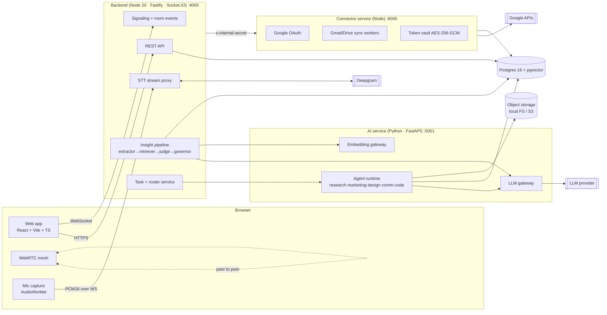
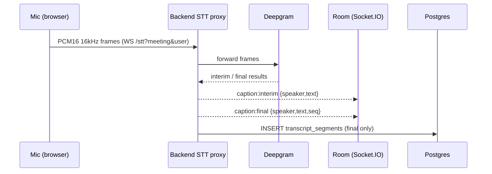
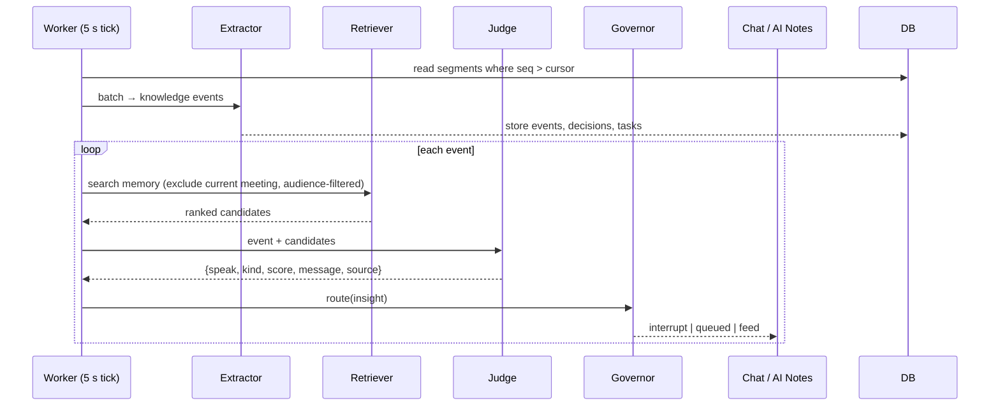

# 01 · System Architecture

Companion to [PRD.md](../PRD.md). This document answers *how* MeetPilot is built.

## 1. Design principles

1. **Quiet by design** – the AI pipeline is split into *detect → retrieve → judge → govern*; only the governor writes to the shared chat.
2. **Text only** – audio is streamed to the STT provider and never stored.
3. **Private by default** – every read path carries an *audience filter* (`owner_id`, `visibility`).
4. **Degrade gracefully** – every AI dependency has a rules-based or no-op fallback; the room (video, chat, notes) never depends on AI services.
5. **Small-team scale** – single node, P2P mesh video, in-memory governor state. Seams are documented where scale-out would go.

## 2. Service topology



| Service | Port | Responsibility | Owns data |
|---|---|---|---|
| `web` | 5173 | UI, WebRTC, mic capture, captions rendering | none (localStorage: username) |
| `backend` | 4000 | REST, Socket.IO rooms, STT proxy, insight pipeline, task extraction, router | all relational tables |
| `ai` | 5001 (not 5000: macOS AirPlay uses it) | Stateless LLM/embedding calls, agent runs, artifact generation | `executions` artifacts (via backend API) |
| `connector` | 6000 | Google OAuth, sync, token vault, send-email | `connections`, `external_items`, encrypted tokens |
| `postgres` | 5432 | Relational + vector storage | — |

Service-to-service calls carry `x-internal-secret`; backend and connector **fail closed** if `INTERNAL_SECRET` is unset.

## 3. Technology choices

| Concern | Choice | Why |
|---|---|---|
| Frontend | React 18, Vite, TypeScript, Zustand, Tailwind | Fast dev loop; small state needs |
| Realtime | Socket.IO | Rooms, reconnection, ack callbacks out of the box |
| Video | Native WebRTC, full mesh, STUN only | No media server for ≤6 people (TURN *planned*) |
| STT | Deepgram streaming WS (`nova-2`, interim results) with async chunk fallback | Lowest latency; fallback for outages |
| DB | Postgres + `pgvector` | One store for relational + semantic search; Docker one-liner |
| ORM / migrations | Drizzle ORM + SQL migrations | Typed, explicit SQL |
| AI service | FastAPI + Pydantic | Structured-output validation of LLM JSON |
| LLM | Provider-agnostic gateway (default: Claude) | Judge, extractor and agents share one client with retries |
| Embeddings | 1536-dim, provider-configurable; **fake deterministic embedder when no key** | Tests run offline (see PRD risk table) |
| Jobs | In-process interval workers + `jobs` table (at-least-once) | No Redis dependency at this scale |
| Auth | Username only (header `x-user`) – documented limitation | Matches PRD non-goals |

## 4. Runtime flows

### 4.1 Live caption path

Each participant transcribes **their own** mic, so speaker attribution is exact without diarization.

### 4.2 Insight path (AI Assistance on)


### 4.3 End-of-meeting path
`POST /meetings/:id/end` → status `ended` → broadcast `meeting:ended` → final extraction pass → task finalisation → `meeting:tasks_ready` (drives the overlay) → recap insight → router enqueues one `execution` per agent-doable task → agents run → `execution:ready_for_review` notification to the assignee.

## 5. Repository layout (target)

```
meetpilot/
├─ PRD.md
├─ docs/                    # these design docs
├─ apps/
│  ├─ web/                  # React app
│  ├─ backend/              # Fastify + Socket.IO
│  ├─ ai/                   # FastAPI
│  └─ connector/            # Google connector
├─ packages/
│  └─ shared/               # zod schemas + TS types for events/REST
├─ infra/
│  ├─ docker-compose.yml    # postgres+pgvector
│  └─ start.sh              # one-command start with per-service logs
└─ .env.example
```

## 6. Configuration (env)

| Var | Service | Purpose |
|---|---|---|
| `DATABASE_URL` | backend, connector | Postgres |
| `INTERNAL_SECRET` | all | service auth |
| `DEEPGRAM_API_KEY`, `STT_MODE=stream\|async\|off` | backend | speech |
| `LLM_API_KEY`, `LLM_MODEL`, `EMBEDDING_PROVIDER=real\|fake` | ai | models |
| `GOOGLE_CLIENT_ID/SECRET`, `TOKEN_ENC_KEY` (32 B) | connector | OAuth + vault |
| `AI_GOVERNOR_MAX_CHAT=6`, `…_WINDOW_MIN=30` | backend | governor caps |

## 7. Scale-out seams (not built)
- Governor state → Redis; jobs → a queue; mesh → SFU (LiveKit); auth → OIDC; add TURN.
