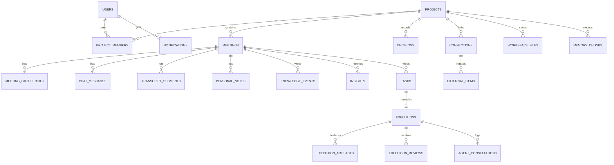

# 02 · Data Model & Project Memory

Postgres 16 + `pgvector`. All ids are `uuid` (default `gen_random_uuid()`); all timestamps `timestamptz`.

## 1. Entity relationship overview



## 2. Tables

### 2.1 Identity & structure
```sql
users(id, username text unique not null, created_at)

projects(id, name, description, owner_id → users, share_workspace bool default false, created_at)
project_members(project_id, user_id, role text check (role in ('owner','member')), primary key(project_id,user_id))

meetings(
  id, project_id → projects on delete cascade, owner_id → users,
  title text not null, description text,
  status text check (status in ('scheduled','active','ended','closed')) default 'active',
  scheduled_at timestamptz null,           -- null = instant call
  started_at, ended_at, closed_at,
  total_duration_sec int default 0,        -- summed across sessions (F2.7)
  share_chat_transcript bool default false,
  share_workspace bool default false,
  ai_assist bool default false,
  created_at)

meeting_participants(meeting_id, user_id, invite_status text check in ('invited','accepted','declined','joined'),
  joined_at, last_session_started_at, primary key(meeting_id,user_id))
```
Status machine: `scheduled → active` (first join) `→ ended` (owner End) `→ closed` (final, no rejoin). Instant calls start at `active`.

### 2.2 Conversation
```sql
chat_messages(id, meeting_id, user_id null, kind text check in ('user','ai_insight'), body text, insight_id null, created_at)
  index (meeting_id, created_at desc)       -- latest-first paging (F3.4)

personal_notes(meeting_id, user_id, body text, updated_at, primary key(meeting_id,user_id))

transcript_segments(
  id, meeting_id, user_id, speaker_name text, text text, confidence real,
  seq int not null,                         -- per-meeting monotonically increasing
  started_at_ms int, created_at,
  unique(meeting_id, seq))
```

### 2.3 Knowledge & memory
```sql
knowledge_events(
  id, meeting_id, project_id, segment_from_seq int, segment_to_seq int,
  type text check in ('task','decision','deadline','question','blocker','info'),
  entity_key text null,                     -- e.g. 'deployment_date'
  summary text, who text, due_at timestamptz null,
  references_earlier bool default false,    -- "as we discussed"
  quote text, created_at)

decisions(id, project_id, entity_key, value text, meeting_id, event_id, superseded_by uuid null, created_at)
  index (project_id, entity_key, created_at desc)   -- versioned history

memory_chunks(
  id, project_id, source_type text check in
    ('transcript','event','decision','task','workspace_doc','code'),
  source_id uuid, meeting_id uuid null, text text, embedding vector(1536),
  created_at)
  index ivfflat/hnsw (embedding vector_cosine_ops), index (project_id, source_type)
```

### 2.4 Insights
```sql
insights(
  id, meeting_id, project_id,
  kind text check in ('conflict','answer','reminder','context','no_record','external','brief','recap'),
  tier text check in ('interrupt','queued','feed'),
  title, body text, quote text null,
  source_label text, source_url text null,          -- "Meeting · Jul 12", "Gmail · Alice · Re: Q3"
  score real, topic_key text,
  audience_user_id uuid null,                        -- NOT NULL ⇒ private (F5.13): AI Notes of that user only
  feedback text null check in ('helpful','dismissed'),
  delivered_to_chat bool, created_at)
  index (meeting_id, created_at desc), index (meeting_id, audience_user_id)
```

### 2.5 Tasks & agents
```sql
tasks(
  id, meeting_id, project_id, title, description,
  assigned_to uuid null, assigned_by uuid null, due_date date null,
  priority text, category text check in ('code','marketing','design','communication','research','general'),
  status text check in ('open','in_progress','review','done') default 'open',
  parent_task_id null, finalized bool default false, created_at)    -- creation date = created_at
task_history(id, task_id, field, old, new, changed_at)

executions(
  id, task_id unique,                      -- one execution per task, ever (idempotent routing)
  agent text, status text check in
    ('routed','running','awaiting_review','changes_requested','approved','failed','skipped_human'),
  revision int default 0, summary text, error text, reviewer_id → users, created_at, updated_at)
execution_artifacts(id, execution_id, revision int, type text check in
  ('markdown','image','pdf','video','diff','link','file','email_draft'), title, uri text, payload jsonb)
execution_reviews(id, execution_id, revision, reviewer_id, verdict text check in ('approve','changes'),
  comment text, line_comments jsonb, created_at)
agent_consultations(id, execution_id, from_agent, to_agent, question, answer, depth int, created_at)
email_sends(id, execution_id, artifact_id, message_hash text, recipients jsonb, sent_at,
  unique(execution_id, message_hash))                        -- duplicate-send guard (F9.9)
```

### 2.6 Integrations & workspace
```sql
connections(id, project_id, user_id, provider text check in ('gmail','drive'),
  visibility text check in ('private','project') default 'private',
  config jsonb,                             -- labels, lookback_days, folder_ids
  scopes text[], status text, last_sync_at, token_ciphertext bytea, token_iv bytea, token_tag bytea)

external_items(id, connection_id, project_id, owner_id, provider, external_id, title, author, url,
  visibility text, occurred_at, text text, embedding vector(1536), unique(connection_id, external_id))

workspace_files(id, project_id, path, kind text check in ('cloud','local'), size, mime, summary, updated_at,
  unique(project_id, path))
notifications(id, user_id, type text check in ('invite','review_ready'), payload jsonb, read_at null, created_at)
jobs(id, kind, payload jsonb, run_at, attempts int, status, last_error)    -- at-least-once worker queue
```

## 3. Project-memory semantics

| Concern | Rule |
|---|---|
| **Chunking** | Transcript: sliding window of ~6 segments / ≤ 800 chars with 1-segment overlap. Docs: ≤ 1 000 chars, paragraph-aware. Email: per message body, quoted replies stripped. |
| **Search** | `search(project_id, query, {types, exclude_meeting_id, viewer_id, k})` → cosine top-k per source type, then merged. |
| **Audience filter** | A row is readable iff `visibility='project'` OR `owner_id = viewer_id`. Applied **inside SQL** on every read, never post-filtered in app code. |
| **Relevance** | Drop similarity < 0.55 (real embeddings) before reaching the judge. |
| **Context package** | `{files≤4, tasks≤5, meetings≤4, decisions≤5, requirements≤3, artifacts≤3, discussions≤4, external≤3}`, each snippet ≤ 400 chars, total ≤ 6 000 chars; shared by live assistant and agents. |
| **Decisions** | New decision with same `entity_key` and different `value` sets `superseded_by` on the old row and is the basis for *Conflict* insights. |
| **Cascade** | `ON DELETE CASCADE` from project→meetings→derived rows; `memory_chunks`/`external_items` deleted by `source_id` / `project_id` triggers; disconnect deletes `external_items` + token columns for that connection. |

## 4. Retention & privacy
No audio/video persisted. Tokens only in `connections.token_*`, never selected by any API serializer. Deleting an account removes owned projects (cascade) and memberships.
